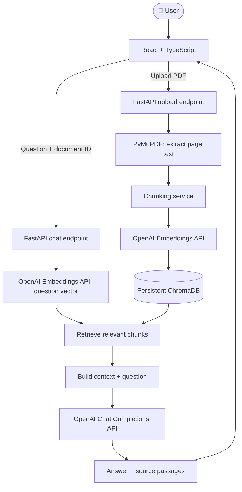
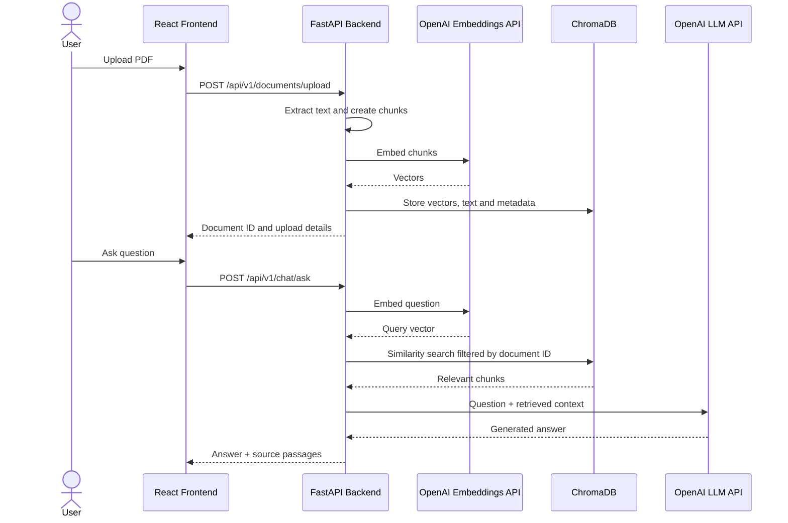

<div align="center">

# 📚 KnowledgeForge AI

### Understand documents. Discover knowledge.

**Upload PDFs · Ask questions · Get AI-generated answers grounded in your documents**


</div>

---

## 📖 Overview

**KnowledgeForge AI** is a full-stack document question-answering application built with **Retrieval-Augmented Generation (RAG)**. Users upload a PDF, the backend extracts and chunks its text, embeddings are stored in ChromaDB, and an LLM API generates answers using relevant retrieved passages.

The project demonstrates how to connect a React frontend, a Python API, a vector database, an embeddings API, and an LLM API in one application.

> **Current implementation:** OpenAI API + ChromaDB + FastAPI + React. LangChain is discussed as a possible framework, but the current code uses the OpenAI SDK directly and does not currently use `LLMChain`.

## ✨ Features

<table>
  <tr>
    <td width="50%">
      <h3>📄 PDF Upload & Extraction</h3>
      Upload PDF files and extract text page by page using PyMuPDF.
    </td>
    <td width="50%">
      <h3>🧩 Text Chunking</h3>
      Split extracted text into smaller chunks with overlap to preserve context.
    </td>
  </tr>
  <tr>
    <td>
      <h3>🧠 Embedding API</h3>
      Use OpenAI's embedding API to convert document chunks and questions into vectors.
    </td>
    <td>
      <h3>🗄️ Persistent Vector Store</h3>
      Store embeddings, text, and metadata in a local persistent ChromaDB collection.
    </td>
  </tr>
  <tr>
    <td>
      <h3>🤖 LLM API Answer Generation</h3>
      Call OpenAI's Chat Completions API to answer questions from retrieved PDF context.
    </td>
    <td>
      <h3>🔎 Source Passages</h3>
      Return relevant passages and page numbers so users can verify the answer.
    </td>
  </tr>
</table>

## 🖼️ Application screenshot

Add a screenshot of your running application to the repository, for example at `docs/screenshots/app.png`, and then use:

```markdown

```

This section is a placeholder until you add a real screenshot from your app.

## 🧰 Technology stack

| Technology / library | Purpose |
|---|---|
| **Python 3.11** | Backend language |
| **FastAPI** | REST API and PDF upload/question endpoints |
| **Uvicorn** | Runs the ASGI backend |
| **Pydantic** | Request/response schema validation |
| **pydantic-settings** | Loads configuration from environment variables |
| **PyMuPDF (`pymupdf`)** | Extracts text from PDF pages |
| **Custom Python chunking** | Splits text into character-based chunks with overlap |
| **OpenAI Python SDK** | Makes embedding and LLM API requests |
| **OpenAI `text-embedding-3-small`** | Creates vector embeddings for chunks and questions |
| **OpenAI `gpt-4.1-mini`** | LLM used to generate document-grounded answers |
| **ChromaDB** | Stores vectors, chunk text, and metadata persistently |
| **`python-multipart`** | Supports multipart PDF uploads |
| **React** | Builds the user interface |
| **TypeScript** | Adds static types to frontend code |
| **Vite** | Frontend development server and build tool |

## 🧠 AI techniques and concepts

### 1. Retrieval-Augmented Generation (RAG)

RAG retrieves relevant external context before asking an LLM to generate an answer. In this project, the context comes from the PDF uploaded by the user.

### 2. Embeddings

The OpenAI Embeddings API transforms text into numerical vectors. The application embeds both document chunks and user questions so ChromaDB can find semantically similar content.

### 3. Vector similarity search

ChromaDB stores embeddings together with chunk text and metadata such as `document_id`, `page_number`, and `chunk_index`. Searches are filtered by `document_id` to retrieve chunks from the selected document.

### 4. LLM API integration

The project calls a hosted LLM through the OpenAI Python SDK. The chat service sends a system instruction, the user's question, and retrieved document context to the Chat Completions API. The model generates a natural-language answer based on the supplied context.

**This is a real LLM API integration.** It is not a hard-coded or simulated answer. Calls require available OpenAI API credits.

### 5. Prompt engineering and grounded answers

The system prompt instructs the model to use only the retrieved context, say when information is missing, and cite supporting pages using `[Page N]`. Since model output can still be incorrect, users should verify important claims against the returned source passages.

### 6. Chunking with overlap

Current defaults:

| Setting | Default | Purpose |
|---|---:|---|
| `CHUNK_SIZE` | `1000` characters | Maximum characters in a chunk |
| `CHUNK_OVERLAP` | `150` characters | Shared text between adjacent chunks on a page |
| `top_k` | `5` | Number of retrieved chunks requested |

The current chunker processes each page independently, so overlap does not cross page boundaries.

### 7. LangChain and LLMChain

LangChain is a framework that offers components for prompts, models, retrievers, and chains. `LLMChain` is a historical LangChain abstraction for combining a prompt template with an LLM.

**LangChain and `LLMChain` are not currently used by this implementation.** The project currently implements the RAG orchestration with custom Python services, ChromaDB, and the OpenAI SDK. LangChain could be introduced later if reusable chain or retriever abstractions become useful.

## 🔄 Visual RAG workflow



## 🔁 Question-answering sequence



## 🏗️ Project structure

```text
knowledgeforge-ai/
├── backend/
│   ├── app/
│   │   ├── main.py
│   │   ├── core/
│   │   │   └── config.py
│   │   ├── api/v1/endpoints/
│   │   │   ├── documents.py
│   │   │   └── chat.py
│   │   ├── schemas/
│   │   │   ├── document.py
│   │   │   └── chat.py
│   │   └── services/
│   │       ├── pdf_service.py
│   │       ├── chunking_service.py
│   │       ├── vector_store.py
│   │       └── chat_service.py
│   ├── data/chroma/        # Local vector data; do not commit
│   ├── .env                # API key; do not commit
│   └── requirements.txt
└── frontend/
    ├── src/
    │   ├── api/
    │   │   ├── documents.ts
    │   │   └── chat.ts
    │   ├── components/
    │   │   ├── documents/PDFUploader.tsx
    │   │   └── chat/ChatPanel.tsx
    │   ├── types/document.ts
    │   ├── App.tsx
    │   └── App.css
    └── package.json
```

*This illustrates the intended main files. Adjust the names if your actual repository differs.*

## ⚙️ Getting started

### Prerequisites

- Python 3.11
- Node.js and npm
- An OpenAI API key with available API credits

### Step 1 — Clone the repository

```powershell
git clone <YOUR_GITHUB_REPOSITORY_URL>
cd knowledgeforge-ai
```

Replace `<YOUR_GITHUB_REPOSITORY_URL>` with your actual GitHub repository URL.

### Step 2 — Create and install the backend environment

```powershell
cd backend
python -m venv venv
.\venv\Scripts\Activate.ps1
python -m pip install --upgrade pip
python -m pip install -r requirements.txt
```

If `requirements.txt` is not ready, install the core dependencies:

```powershell
python -m pip install "fastapi[standard]" pydantic-settings pymupdf python-multipart chromadb openai
```

### Step 3 — Configure environment variables

Create `backend/.env`:

```env
OPENAI_API_KEY=your_openai_api_key
OPENAI_EMBEDDING_MODEL=text-embedding-3-small
OPENAI_CHAT_MODEL=gpt-4.1-mini
CHUNK_SIZE=1000
CHUNK_OVERLAP=150
```

Never commit `.env` or expose your API key. Add the following to `backend/.gitignore`:

```gitignore
.env
venv/
.venv/
__pycache__/
*.py[cod]
data/
```

Run backend commands from the `backend/` folder so `pydantic-settings` can load `.env`.

### Step 4 — Run the backend

From `backend/`:

```powershell
.\venv\Scripts\python.exe -m uvicorn app.main:app --reload
```

Backend URLs:

- Health check: http://127.0.0.1:8000/health
- Interactive Swagger docs: http://127.0.0.1:8000/docs

Keep this terminal open.

### Step 5 — Run the frontend

Open a second terminal at the repository root:

```powershell
cd frontend
npm install
npm run dev
```

Open the local URL printed by Vite, usually http://localhost:5173.

### Step 6 — Use KnowledgeForge AI

1. Open the frontend in your browser.
2. Choose and upload a text-based PDF.
3. The backend extracts text and splits it into chunks.
4. The OpenAI Embeddings API creates vectors for the chunks.
5. Chunks, vectors, and metadata are stored in ChromaDB.
6. Enter a question about the uploaded PDF.
7. The question is embedded and used to retrieve relevant chunks.
8. The OpenAI LLM API generates an answer from the retrieved context.
9. The frontend displays the answer and source passages.

> **Billing:** Upload and question-answering workflows call OpenAI APIs. An error such as `credit_balance_exhausted` means the API account needs available credits or valid billing. ChatGPT subscriptions and API billing are separate. Scanned/image-only PDFs may need OCR, which is not included in this MVP.

## 🔌 API endpoints

### `GET /health`

Checks that the backend is running.

Example response:

```json
{
  "status": "healthy",
  "application": "KnowledgeForge AI"
}
```

### `POST /api/v1/documents/upload`

Uploads a PDF as multipart form data. The response includes the extracted text, page count, generated `document_id`, and number of chunks stored.

### `POST /api/v1/chat/ask`

Example request:

```json
{
  "document_id": "YOUR_DOCUMENT_ID",
  "question": "What are the main ideas in this document?",
  "top_k": 5
}
```

Use the `document_id` returned by a successful upload. The response includes the question, generated answer, and source chunks with page numbers.

## 🧯 Troubleshooting

| Error or issue | What to check |
|---|---|
| `credit_balance_exhausted` | Check OpenAI API billing and available credits |
| `Form data requires python-multipart` | Install `python-multipart` in the active backend environment |
| `ModuleNotFoundError` | Confirm commands use the intended virtual environment |
| Frontend cannot connect | Check backend port, API base URL, and FastAPI CORS origins |
| Blank or unstyled frontend | Check browser console, component import paths, and CSS |
| PDF has no extracted text | It may be scanned or image-only; OCR is not currently implemented |

If Windows uses the wrong Python environment, run the intended interpreter explicitly:

```powershell
.\venv\Scripts\python.exe -m pip --version
.\venv\Scripts\python.exe -m uvicorn app.main:app --reload
```

## 🔐 Security and limitations

- Never commit API keys, `.env`, private PDFs, or local ChromaDB data.
- The MVP does not yet include user authentication or per-user document authorization.
- Retrieval is filtered by `document_id`, but production deployments should enforce document ownership server-side.
- OCR, streaming responses, conversation history, and automated tests are not yet implemented.
- LLM answers can be incorrect. Verify important claims against the source passages.
- Add authentication, rate limits, retention controls, tests, and secure secret management before production use.

## 🛣️ Roadmap

- [ ] Improve retrieval quality and evaluate grounded answers
- [ ] Add conversation history and streaming responses
- [ ] Support multiple documents per workspace
- [ ] Add OCR for scanned PDFs
- [ ] Add authentication and document access control
- [ ] Add automated tests, CI, and Docker
- [ ] Deploy backend and frontend
- [ ] Explore LangChain retrievers/chains if useful
- [ ] Add summaries, quizzes, and flashcards

## 📄 License

Choose a license before publishing publicly and add the matching `LICENSE` file (for example, MIT).

---

<div align="center">

**Built to learn full-stack development, RAG, embeddings, vector databases, and LLM API integration.**

</div>
